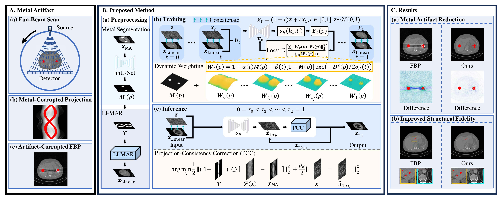
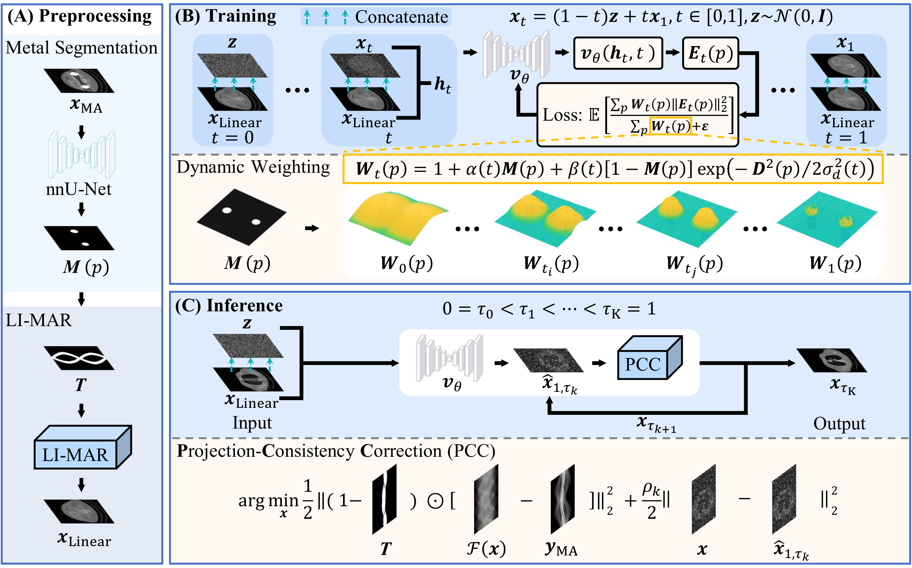
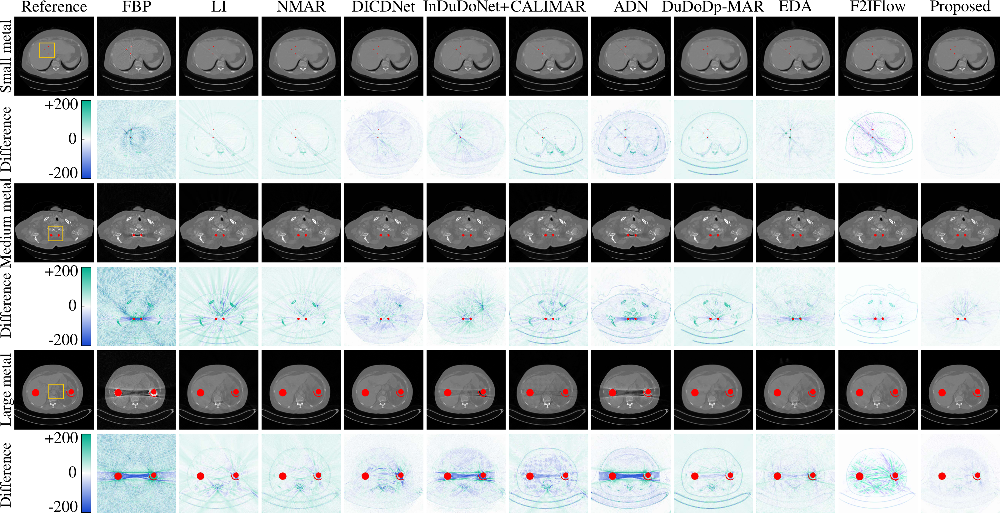
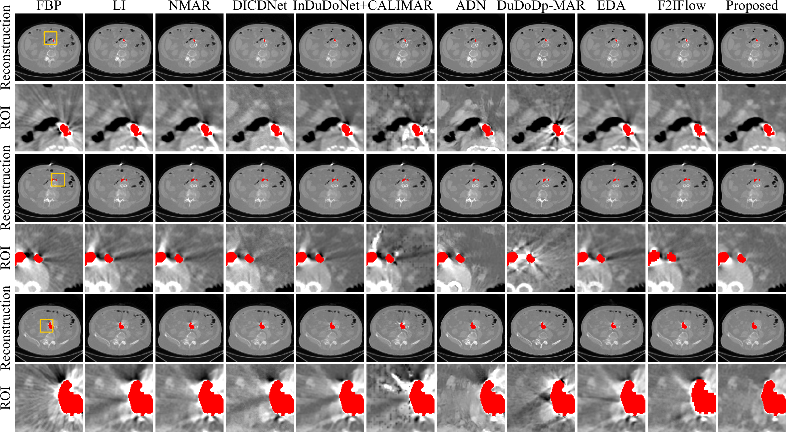
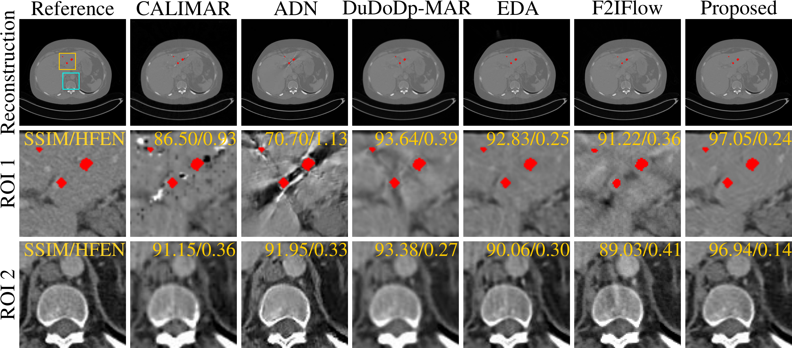

# SCMA: Structure-Conditioned and Metal-Aware Flow Matching for CT Metal Artifact Reduction

**Heran Wang, Jianing Sun, Xu Jiang, Genwei Ma, Jigang Duan<sup>&#42;</sup>, and Xing Zhao<sup>&#42;</sup>**

*Corresponding authors: Jigang Duan and Xing Zhao.*

[**Paper (arXiv)**](https://arxiv.org/abs/2607.28759)

> **Repository status:** An initial code release is available. A more complete implementation is being organized for a subsequent update.

## Abstract

Metallic objects in CT can cause severe streaks, dark bands, and structural distortions. SCMA is a structure-conditioned and metal-aware Flow Matching framework for metal artifact reduction. It combines three complementary components: an image corrected by linear interpolation (LI) provides sample-specific structural guidance; time-varying spatial weights derived from the metal mask and its distance transform emphasize learning within and around metal regions; and projection-consistency correction (PCC) uses projections outside metal traces to constrain predictions during inference. Experiments on simulated and clinical CT data demonstrate effective artifact suppression and preservation of local anatomical structures.

## Graphical Abstract

<p align="center">
  
</p>

*Graphical abstract.* SCMA combines sample-specific structural conditioning, metal-aware velocity-field training, and projection-consistency correction. [View PDF](assets/graphical_abstract.pdf).

## Method Overview

<p align="center">
  
</p>

SCMA consists of three stages:

1. **Preprocessing.** A pretrained nnU-Net estimates an image-domain metal mask. Forward projection of this mask defines the metal trace. Linear interpolation within the trace followed by reconstruction produces the conditioning image.
2. **Structure-conditioned and metal-aware training.** The velocity network receives an intermediate Flow Matching state concatenated with the LI-corrected image, together with the time variable. A weighted velocity-regression loss uses the metal mask and its distance transform. The emphasized neighborhood contracts from a broad region near the noise endpoint to a local region near the image endpoint.
3. **Inference with PCC.** Starting from Gaussian noise, the state evolves under the fixed LI condition. At each step, the network predicts a velocity, from which an artifact-free endpoint is estimated. PCC refines this endpoint using projections outside the metal trace, and the correction is fed back into the next state update.

The metal mask guides the training loss and defines the trace used for LI and PCC. The conditional velocity network takes the current state, the LI condition, and time as inputs; metal localization remains part of the full inference pipeline. [View method figure PDF](assets/method_overview.pdf).

## Highlights

- **Sample-specific structural guidance:** an LI-corrected image conditions the restoration trajectory.
- **Time-varying regional emphasis:** metal-aware weighting strengthens learning within and around metal regions.
- **Measurement-constrained inference:** PCC alternates with conditional Flow Matching updates to improve consistency outside metal traces.
- **Evaluation across metal sizes and clinical datasets:** experiments examine artifact reduction and local structural fidelity.

## Representative Results

### Visual comparison across metal sizes

<p align="center">
  
</p>

*Simulated CT results.* Each reconstruction row is followed by its difference maps relative to the reference. CT images and difference maps use display windows of [-1000, 800] HU and [-200, 200] HU, respectively. Metal regions are marked in red. **Proposed** denotes SCMA throughout the result figures. [View PDF](assets/visual_comparison.pdf).

### Quantitative comparison

The simulated benchmark contains 2,000 test pairs constructed from 200 metal-free images and 10 held-out metal masks. The table reports the manuscript's **Average** means, which equally weight the small, medium, and large metal-size categories. Evaluation excludes metal and background; SSIM is reported in percent.

| Method | PSNR (dB) ↑ | SSIM (%) ↑ |
|---|---:|---:|
| FBP | 13.67 | 57.26 |
| LI | 29.10 | 75.86 |
| NMAR | 38.68 | 88.37 |
| DICDNet | 45.08 | 98.84 |
| InDuDoNet+ | 41.46 | 98.15 |
| CALIMAR | 35.55 | 88.41 |
| ADN | 33.53 | 93.47 |
| DuDoDp-MAR | 36.76 | 87.57 |
| EDA | 37.45 | 93.06 |
| F2IFlow | 39.48 | 92.28 |
| **SCMA** | **47.56** | **99.04** |

Results are reported from the current manuscript revision, which may contain updates relative to the linked arXiv version.

### Clinical results using acquired projections

<p align="center">
  
</p>

*Clinical CT results.* Three representative slices from the TCIA Low Dose CT Image and Projection Data collection are shown with metal-adjacent ROIs. LI and PCC use acquired projections and the acquisition geometry. Images and ROIs use display windows of [-1000, 800] HU and [-350, 250] HU, respectively. [View PDF](assets/clinical_results.pdf).

The manuscript also evaluates CTSpine1K, where scanner projections are unavailable and LI/PCC instead use virtual projections generated from reconstructed clinical images.

### Local structural fidelity

<p align="center">
  
</p>

*Local structural fidelity in one simulated test example.* ROI 1 is adjacent to metal, and ROI 2 covers the spine. Yellow annotations report SSIM (%, higher is better) and HFEN (lower is better) against the corresponding reference ROI. These values describe the displayed example. [View PDF](assets/structural_fidelity.pdf).

## Code

This repository contains the initial SCMA code release. Additional code and usage documentation will be added as they are organized.

## Citation

If you find this work useful, please cite:

```bibtex
@misc{wang2026scma,
  title         = {{SCMA}: Structure-Conditioned and Metal-Aware Flow Matching for {CT} Metal Artifact Reduction},
  author        = {Wang, Heran and Sun, Jianing and Jiang, Xu and Ma, Genwei and Duan, Jigang and Zhao, Xing},
  year          = {2026},
  eprint        = {2607.28759},
  archivePrefix = {arXiv},
  url           = {https://arxiv.org/abs/2607.28759}
}
```

## Contact

For questions or updates, please open an issue in this repository.
